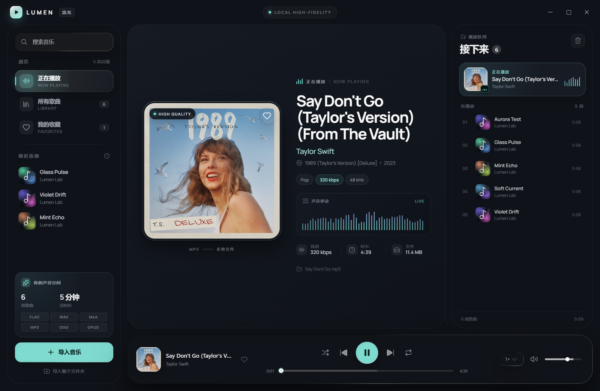
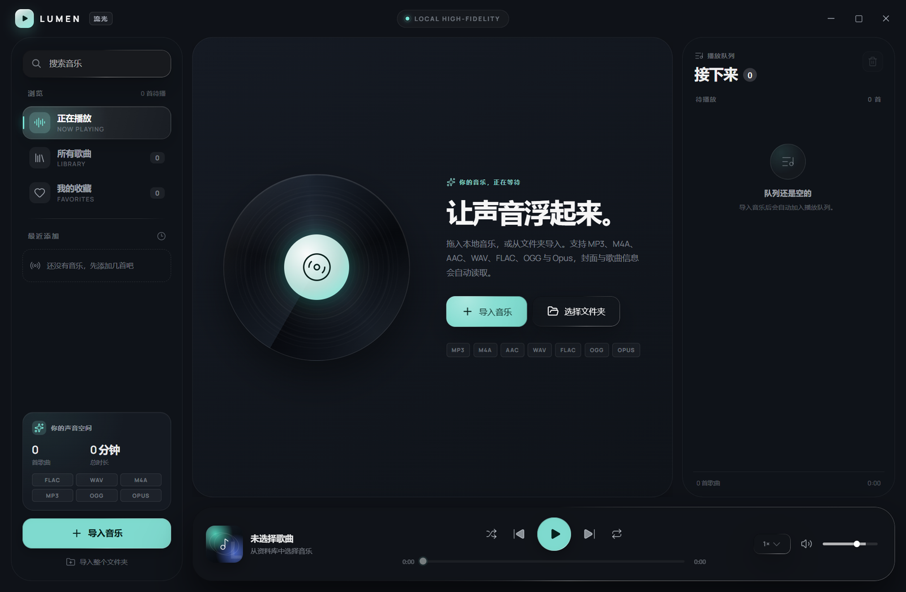
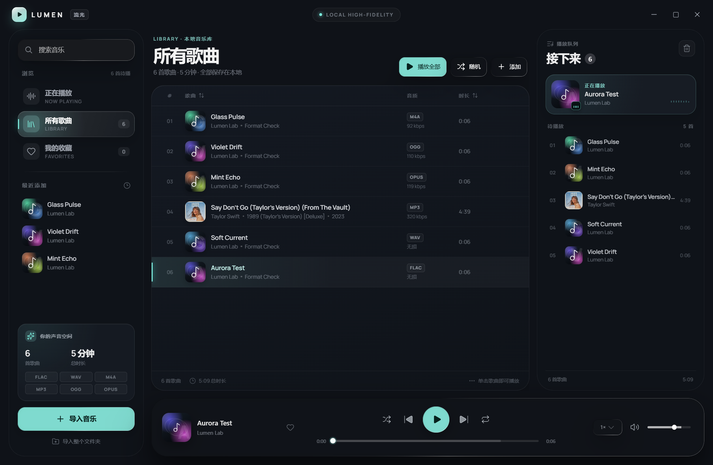
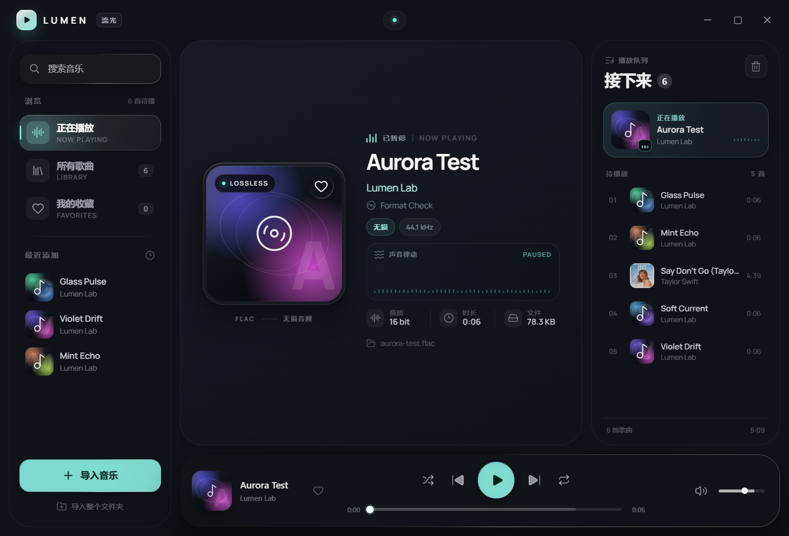

# 流光 Lumen

面向 Windows 的液态玻璃风格本地音乐播放器，使用
[`@ttqtt/liquid-glass-react`](https://tsdsj.github.io/liquid-glass-react/#/components)
构建。当前发布版为单版本 **Lumen 1.1.1**。源码仓库：
[github.com/yhchank/lumen-glass-player](https://github.com/yhchank/lumen-glass-player)



## 设计原则

> 只有该浮起来的才浮起来。玻璃留给工具栏、标签栏和弹出面板；正文、列表、卡片保持不透明。

Lumen 按这一原则划分层级：

- **不透明内容层**：左侧导航、正在播放主卡片、播放队列、音乐库表格和所有内容卡片。
- **玻璃层**：底部播放工具栏、浮动菜单 / 弹出面板、Toast、导入进度和拖放覆盖层。
- **固定主题**：青绿 `#79e9da` + 淡紫 `#a495ff`，不随专辑封面取色。
- **静态背景**：纯色 `#0f1218`，没有动态渐变、极光、光球或封面模糊背景。
- **Canvas 频谱**：播放时 30fps，暂停时完全停止绘制。
- **柔和边线**：玻璃边光和内容边框整体压低，避免白线抢视线。

内容区域不采样背景；只有播放工具栏和真正的浮动层使用玻璃材质。

## 功能

- **本地音乐播放**：MP3、M4A、M4B、AAC、WAV、FLAC、OGG、OGA、OPUS。
- **播放控制**：播放 / 暂停、上一首 / 下一首、拖动进度、音量、静音、随机、列表循环、单曲循环、0.75×–2× 倍速。
- **本地资料库**：读取标题、艺人、专辑、年份、流派、时长、码率、采样率、位深和内嵌封面。
- **队列与收藏**：右侧播放队列、文件夹批量导入、收藏、搜索、排序、移除与撤销。
- **Windows 集成**：无边框窗口、系统媒体控制、任务栏缩略图按钮、任务栏播放进度、窗口位置记忆。
- **本地持久化**：资料库、队列、收藏、音量、播放模式和窗口状态在重启后恢复。
- **键盘友好**：主要操作都有快捷键，交互控件带有可访问名称。







## 资源占用

本机（Windows 11、1320×860 窗口、播放状态）使用 Electron
`app.getAppMetrics()` 与 Playwright 做一次采样，仅供相对参考：

| 指标 | 当前版本 |
| --- | ---: |
| GPU 进程 CPU | 约 0.6% |
| GPU 进程工作集 | 约 364 MB |
| 总内存 | 约 800 MB |
| 总 CPU | 约 1.1% |
| Canvas | 2 |
| 玻璃 Surface | 1（播放工具栏） |
| 持续背景滤镜 / 动画 | 0 |

数值会随 GPU 空闲程度、窗口尺寸和系统设置波动。

## 获取与运行

发布构建通过 [GitHub Releases](https://github.com/yhchank/lumen-glass-player/releases/latest) 分发。
仓库本身只包含源码，不提交二进制安装包。

如果需要在本地构建发布文件：

```bash
npm install
npm run dist
```

产物会写入 `release/`：

- `Lumen-1.1.1-win64.zip` — 解压后双击 `Lumen.exe`。
- `Lumen-Setup-1.1.1.exe` — 安装版，可创建桌面 / 开始菜单快捷方式并注册音频关联。
- `Lumen-1.1.1-Portable.exe` — 单文件便携版。

当前发布版尚未做商业代码签名，Windows 可能显示“未知发布者”提示。
选择“更多信息 → 仍要运行”即可。

### 数据位置

默认用户数据目录：`%APPDATA%\Lumen`。

如果目录不可写，启动器会退回到程序目录下的 `LumenData`，最后才使用临时目录。
卸载程序不会删除资料库；如需彻底清理，请手动删除上述目录。

> 请从 zip 或安装包启动 `Lumen.exe`，不要直接运行 `LumenCore.exe`。
> 外层 exe 负责兼容性参数、数据目录和文件参数转发。

## 使用

1. 点击左下角“导入音乐”，或者把音频文件 / 文件夹直接拖进窗口。
2. 单击歌曲行播放；右侧队列显示接下来要播放的歌曲。
3. 点击专辑封面右上角的心形收藏；点击歌曲行右侧的心形也可以收藏。
4. 左侧搜索框可以按歌名、艺人、专辑或文件名搜索。
5. 使用底部播放条控制进度、音量、随机与循环。

### 快捷键

| 快捷键 | 功能 |
| --- | --- |
| `Space` | 播放 / 暂停 |
| `←` / `→` | 后退 / 前进 5 秒 |
| `Shift` + `←` / `→` | 降低 / 提高音量 |
| `M` | 静音 / 取消静音 |
| `N` / `P` | 下一首 / 上一首 |
| `Ctrl` + `O` | 导入音乐 |
| `Ctrl` + `F` | 聚焦搜索框 |
| `Esc` | 清空搜索 / 取消焦点 |

### 支持格式

| 容器 / 编码 | 扩展名 |
| --- | --- |
| MPEG Audio | `.mp3` |
| MPEG-4 Audio / AAC | `.m4a`、`.m4b`、`.aac` |
| RIFF PCM | `.wav` |
| FLAC | `.flac` |
| Ogg Vorbis / Opus | `.ogg`、`.oga`、`.opus` |

播放能力来自 Electron 内置 Chromium 的媒体管线；标签和封面通过
`music-metadata` 读取。

## 开发

```bash
npm install
npm run dev          # 开发模式
npm run typecheck    # TypeScript 检查
npm run build        # 构建渲染层到 dist/
npm run pack         # 未压缩目录 release/win-unpacked
npm run dist         # 安装包 / 单文件便携版
```

### 项目结构

```text
electron/
  main.js              # 窗口、IPC、媒体协议、元数据、系统集成
  preload.cjs          # contextBridge 暴露给渲染层的最小 API
  assets/thumbar/      # Windows 任务栏缩略图按钮图标
src/
  App.tsx              # 资料库、队列、导入、全局快捷键
  hooks/               # 播放状态与音频元素控制
  components/          # 标题栏、侧栏、正在播放、队列、表格、播放条
  lib/format.ts        # 时间/体积格式化与搜索文本
  lib/theme.ts         # 固定品牌色板
  styles/global.css    # 全局变量与基础排版
  styles/base.css      # 布局与内容层
  styles/components.css
  styles/appearance.css # 当前版本的层级与材质约束
build/
  launcher/            # Windows 启动器（.NET Framework WinExe）
  after-pack.cjs       # 打包后生成启动器、重命名 Electron 主程序
  icon.ico / icon.png
  使用说明.txt
scripts/
  dev.mjs              # Vite + Electron 开发启动
  start.mjs            # 启动已构建目录
  test-packaged.mjs    # 打包产物集成测试
  capture-ui.mjs       # 截图与紧凑布局检查
archive/               # 归档的旧版本和旧构建附件
```

### 实现说明

- 内容层（侧栏、正在播放、队列、表格、卡片）为不透明实体表面；只有底部播放工具栏和浮动层使用玻璃。
- 主题固定为品牌色板，不再从封面像素提取强调色。
- 玻璃边光、内容边框和按钮内圈白线统一调低亮度。
- Canvas 频谱在播放时以 30fps 绘制，暂停后停止 `requestAnimationFrame`，不会在空闲时持续消耗 GPU。
- `lumen-media://` 是注册为 secure / stream / CORS 的自定义协议；音频响应支持 HTTP Range，因此可以精确拖动进度。
- 封面在导入时抽取并缓存到用户数据目录，避免把大图塞进 `localStorage`。
- 渲染层通过 `contextBridge` 获得文件对话框、导入、路径验证、窗口控制等有限能力，无法直接访问 Node.js。
- 启动器为兼容部分 Windows 安全策略，默认传入 `--no-sandbox`。应用不加载远程网页，只读取本地文件。若需要 Chromium 进程沙箱，请设置环境变量 `LUMEN_ENABLE_SANDBOX=1` 再启动。

### 打包说明

`electron-builder` 打包完成后，`build/after-pack.cjs` 会把 Electron 主程序重命名为
`LumenCore.exe`，再用 Windows 自带的 C# 编译器生成一个小型启动器 `Lumen.exe`。
启动器负责选择可写的数据目录、传入兼容性参数、转发文件关联参数并启动 Core。

## 验证

```bash
node scripts/test-packaged.mjs
node scripts/capture-ui.mjs
```

集成测试覆盖：

- 启动参数导入 6 个文件；
- MP3 / M4A / AAC / WAV / FLAC / OGG / OPUS 的 Chromium 播放能力；
- 5 种格式的实际播放与时长；
- 自定义协议的 `206 Partial Content`；
- 封面读取；
- 收藏、搜索与资料库持久化。

## 归档

早期常规版与低占用版仅保留在本地 `archive/`，不随源码仓库发布。当前唯一发布版为 Lumen 1.1.1。更新记录见 [CHANGELOG.md](CHANGELOG.md)。

## 数据与隐私

音乐与封面只在本机读取和处理，不上传网络。资料库和设置保存在用户数据目录，不会写入音频文件所在目录。

## 致谢

- [Liquid Glass React](https://tsdsj.github.io/liquid-glass-react/#/components) — 液态玻璃组件与材质体系
- [Electron](https://www.electronjs.org/) — Windows 运行时
- [React](https://react.dev/) + [Vite](https://vite.dev/) — 界面与构建
- [music-metadata](https://github.com/Borewit/music-metadata) — 音频标签解析
- [Lucide](https://lucide.dev/) — 图标
- [Manrope](https://github.com/sharanda/manrope) — 字体

## 许可

MIT，详见 `LICENSE`。

